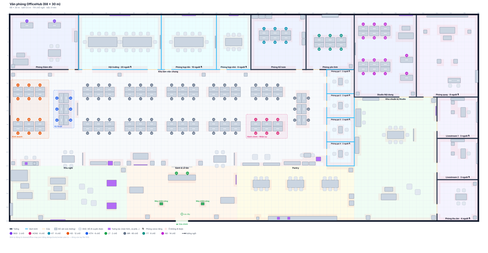

# Đề xuất mở rộng văn phòng 3D lên 1 500 m² (50 × 30 m)

> **Cập nhật 2026-11-06 (sau)**: sàn mở rộng về phía đông thành 68 × 30 m — thêm cánh "Nội dung số" x 50–68 (Studio Nội dung 14 chỗ, Phòng quay, Livestream 1 / 2, Phòng thu âm, Khu chuẩn bị; vào từ Pantry). Mọi toạ độ dưới đây không đổi; nguồn: `design/tools/gen-map-1500.ts`.
>
> Trạng thái: **đã duyệt và áp dụng** (2026-11-06) — `shared/office-map.json` hiện là bản này; các mục 3 / 5 bên dưới đã làm (chỉ còn khác: minimap không cần đổi vì canvas đã co theo CSS 216 px). Bản nháp để xem: [drafts/floor-plan-1500.svg](drafts/floor-plan-1500.svg) (vẽ từ [drafts/office-map-1500.json](drafts/office-map-1500.json), sinh bởi `bun design/tools/gen-map-1500.ts`, kiểm tra bằng `render-plan.ts` sạch lỗi).  Bản hiện tại: 24 × 16 m = 384 m², 24 chỗ, 10 phòng, 107 đồ vật ([office-3d-proposal.md](office-3d-proposal.md), [floor-plan.svg](floor-plan.svg)). Khi duyệt: sửa `shared/office-map.json` + vài hằng số ở mục 5, chạy `bun design/tools/render-plan.ts`, cập nhật test.

## 0. Một lưu ý trước khi duyệt

1 500 m² cho 14 người (24 chỗ hiện có) là ~100 m²/người — gấp 10 lần văn phòng thật. Văn phòng ảo quá rộng thì **ít gặp nhau**, mất điểm "đụng mặt ở pantry". Đề xuất dưới đây xử lý bằng cách: **lõi đông** (sảnh, pantry, khu nghỉ, HCNS, Kinh doanh) nằm sát nhau ở nửa nam; các cụm mở rộng chưa có người đặt xa nhất. Nếu bản vẽ văn phòng thật đã có 1 500 m² thì nên dựng theo bản vẽ thật thay vì mặt bằng này (code không phải đổi).

Kích thước chọn **50 × 30 m = đúng 1 500 m²**, giữ gốc tây-bắc, lưới 0,5 m (100 × 60 = 6 000 ô, A* vẫn tức thì), cửa chính vẫn phía nam.

## 1. Mặt bằng đề xuất



```
z=0  ┌─────────┬──────────────┬──────────┬──────┬──────────┬──────────┐
     │ Giám đốc│ Hội trường   │ Họp lớn  │ Họp  │ Kế toán  │ Phòng    │
     │ 80 m²   │ 20 ng · kính │ 10 · kính│ nhỏ 6│ 64 m²    │ yên tĩnh │
z=8  ├─────────┴──────────────┴──────────┴──────┴──────────┴──────┬───┤
     │  hành lang bắc 1,5 m                                      │B1 │
     │[KD 6][KTH][MR 6][MR 6][MR 6][MR 6][MR 6 ][MR]     hàng A   ├───┤
     │      [ 6 ]------------ lối 2,5 m ---------------[ 6]       │B2 │
     │[KD 6][dọc][MR 6][MR 6][MR 6][MR 6][HCNS 6][dọc] + máy in   ├───┤
z=18 │  ═══════════════ lối đi chính 2 m ═══════════════════════  │B3 │
     │ cà phê·họp nhanh·in ấn·TV tin·[trục]·họp nhanh·sách·HCNS  ├───┤
z=22 ├────────────────────┬──────────────────┬───────────────────┴───┤
     │ Khu nghỉ 136 m²    │ Sảnh & Lễ tân    │ Pantry 136 m²         │
     │ sofa · game · sách │ 2 máy chấm công  │ 3 bàn ăn 18 chỗ · bar │
z=30 └────────────────────┴────▲ cửa chính ──┴───────────────────────┘
     x=0                 17   24  26        33                      50
```

### Phòng có tường (dải bắc z 0–8, cửa mở xuống hành lang)

| id | Tên | x | Kích thước | Ghi chú |
|---|---|---|---|---|
| `bgd` | Phòng Giám đốc | 0–10 | 80 m² | **2 bàn** (`BGD-01..02`, giữ như hiện nay — chủ dự án chốt 2026-11-06), sofa tiếp khách, bàn họp 4 — kênh voice riêng theo khoảng cách như nay |
| `meeting-hall` *(mới)* | Hội trường | 10–22 | 96 m² · kính | 20 chỗ, 2 màn hình, bục; `voice: "room"`, đặt được qua Meetings |
| `meeting-large` | Phòng họp lớn | 22–30 | 64 m² · kính | **giữ id** (lịch đặt phòng đã có `RoomId`), 10 chỗ |
| `meeting-small` | Phòng họp nhỏ | 30–35 | 40 m² · kính | **giữ id**, nâng 4 → 6 chỗ |
| `kt` | Phòng Kế toán | 35–40 | 40 m² | 4 bàn (`KT-01..04`), tủ hồ sơ, két *(2026-11-09: thu từ 6 → 4 chỗ)* |
| `focus` *(mới)* | Phòng yên tĩnh | 40–50 | 80 m² | 8 chỗ không gán phòng ban (`YT-01..08`, zone `quiet`), không voice *(2026-11-09: mở rộng, nhận 2 chỗ từ Kế toán)* |
| `booth-1..4` | Phòng gọi 1–4 | 46–50, mỗi phòng 3,5 m sâu | 14 m² · kính | cột đông khu mở (z 8–22), cửa hướng tây, bàn nhỏ + 2 ghế đối diện, `voice: "room"` |

### Khu mở (`open`, x 0–46, z 8–22, 644 m²)

Từ tây sang đông (chủ dự án chốt 2026-11-06): **Kinh doanh sát tường tây** (2 cụm thường, hàng A + B), **Kỹ thuật** 1 cụm xoay dọc kế bên, rồi **5 cột × 2 hàng** cụm thường (hàng A z 9,5–13; hàng B z 14,5–18) và 1 cụm xoay dọc sát phòng gọi. Cụm thường = 6 chỗ như hiện tại (3 bàn đối diện 3 bàn); khoảng hở giữa các cụm 1,5 m. Lối đi chính 2 m (z 18,2–20,2); dải z 20,2–22 đặt cây, tủ đồ, bảng tin, bảng trắng, máy in.

| Cụm | Khu (`areas[].id`) | Chỗ | Vì sao ở đó |
|---|---|---|---|
| Sát tường tây, hàng A + B | `dept-kd` (giữ id) | 12 (`KD-01..12`) | Bảng trắng trên tường tây |
| Kế bên Kinh doanh (cả 2 hàng) | `dept-kth` (giữ id) | 6 (`KTH-01..06`, 3 bàn đôi **xoay 90°**: bàn xếp dọc, ghế quay mặt đông / tây) | Xa sảnh, yên tĩnh |
| Cột 5, hàng B | `dept-hcns` (giữ id) | 6 (`HCNS-01..06`) | Sát sảnh + pantry, cạnh máy in; tiếp ứng viên |
| 9 cụm thường còn lại + 1 cụm dọc sát phòng gọi | không gán (zone `work`) | 60 (`MR-01..60`) | Dự phòng cho phòng ban mới / dự án; **không** tạo `areas` để khỏi hiện tên khu trống |

### Dải nam khu mở (z 20–22, chủ dự án chốt 2026-11-06)

Lối đi chính z 17,5–20 để trống. Dải z 20–22 từ tây sang đông: (1) góc cà phê phụ (quầy, máy cà phê, bình nước, 2 ghế cao) · (2) bàn trao đổi nhanh 1 (1,8 × 1 m, 4 ghế, bảng trắng di động) · (3) góc in ấn tây (tủ đồ, máy in, tủ hồ sơ) · (4) màn hình thông báo (`interact: notices`) + ghế băng · (5) trục vào sảnh x 22–28 chỉ có cây · (6) bàn trao đổi nhanh 2 · (7) thư viện mini (2 kệ sách, 2 beanbag) · (8) góc HCNS (tủ đồ, 2 tủ hồ sơ, máy in, bàn tiếp ứng viên 2 ghế). Hai bàn trao đổi nhanh ở khu mở → voice theo khoảng cách, không chiếm kênh phòng họp.

### Dải nam (z 22–30)

| Phòng | x | Nội dung |
|---|---|---|
| `lounge` Khu nghỉ | 0–17 | 2 bộ sofa, sofa góc, 4 beanbag, bàn game, kệ sách, TV tường (`interact: screen`) — góc "town-hall" nhỏ |
| `lobby` Sảnh & Lễ tân | 17–33 | Bàn lễ tân (`LT-01..02`), **2 máy chấm công** hai bên lối vào (giảm chen nhau), logo, bảng tin, ghế chờ, cây. Cửa chính `at: 24, w: 2`; spawn (25, 29) |
| `pantry` Pantry | 33–50 | Quầy bếp dài, 2 tủ lạnh, 2 máy cà phê, máy nước, 3 bàn ăn 6 chỗ |

**Tổng chỗ ngồi: 100** (BGĐ 2, KT 6, YT 6, LT 2, KTH 6, KD 12, HCNS 6, MR 60) — đủ cho ~85 người. Đồ vật ~340 (hiện 107). Cửa đều căn lưới 0,5 m, rộng ≥ 1 m; lối đi ≥ 1,5 m.

## 2. Không đổi

Schema v2, thuật toán lưới / A* / `CanStand`, luật voice theo vị trí, hub, Meetings (`GET /rooms` đọc từ bản đồ nên tự thấy `meeting-hall`), `departments.MapZone` (giữ `dept-bgd`, `dept-hcns`, `dept-kt`, `dept-kd`, `dept-kth`, `reception` → **không cần migration**), phím / camera / joystick.

## 3. Phải đổi ngoài JSON (nhỏ, đã rà code)

| Chỗ | Hiện tại | Đổi |
|---|---|---|
| `engine/OfficeScene.ts` (~dòng 88) | Khung bóng đổ của nắng cố định ±16 × ±12 m quanh tâm sàn → với 50 × 30 phần rìa **không có bóng** | Cho khung bóng **đi theo người chơi** (giữ ±16, map 2048) |
| `components/Minimap.tsx` `SCALE = 9` | Minimap 450 × 270 px → che màn hình điện thoại | Tính `SCALE` theo bề rộng tối đa ~240 px (≈ 4,8 px/m) |
| `OfficeScene.zoom` giới hạn 8–32 | Nhìn bao quát khó hơn | Nâng trần lên 40 (tuỳ chọn) |
| `design/tools/render-plan.ts` dòng 202 | Nhãn "Khu làm việc chung" đặt cứng tại (10,5; 5,5) | Lấy tâm phòng `open` |
| `backend/tests/OfficeHub.Realtime.Tests/NavGridTests.cs` | Toạ độ cụ thể của bản 24 × 16 | Viết lại theo bản mới; `office-map.grid.txt` sinh lại |
| `scripts/dev/office-e2e.ts`, `office-chat-e2e.ts`, `voice-e2e.ts` | `walkTo(2.75, 2.75)`, ghế `KTH-02` (3,5; 6,75)… | Cập nhật toạ độ |
| `.agent/business/office.md`, `meetings.md`, `office-3d-proposal.md` | "24 × 16 m", "24 chỗ", 2 phòng họp | Cập nhật cùng commit |

## 4. Hiệu năng & voice

- **Vẽ**: đồ vật gộp theo vật liệu → số draw call không tăng theo số đồ; ~330 đồ low-poly vẫn nhẹ. Khi có GLB (Kenney), mỗi đồ là một clone → nếu laptop tích hợp tụt < 30 FPS thì chuyển bàn / ghế sang `InstancedMesh` (việc riêng, chưa cần ngay).
- **Đi lại**: 4,2 m/s, từ cửa chính tới góc Kỹ thuật ~30 m ≈ 7 s; bấm minimap đi xa đã có. Không đề xuất "dịch chuyển tức thời".
- **Voice khu mở**: vẫn một room LiveKit `officehub-open` cho cả khu mở (có thể 60 người), client chỉ nhận âm trong 6 m (`autoSubscribe: false`) nên băng thông ổn; LiveKit server trên VPS cần đủ CPU cho ~60 publisher. Nếu sau này muốn tách, thêm `voice: "zone"` cho từng `areas[]` — việc riêng.
- **Server**: lưới 6 000 ô bool, `CanStand` O(1); không đổi.

## 5. Cách làm khi duyệt (1 phiên)

1. Chỉnh `design/tools/gen-map-1500.ts` theo góp ý → copy `design/drafts/office-map-1500.json` sang `shared/office-map.json` (sửa `name`, `notes`) → `bun design/tools/render-plan.ts` sạch lỗi.
2. Sửa 4 chỗ FE ở mục 3, viết lại `NavGridTests`, cập nhật e2e.
3. `dotnet build -warnaserror`, `dotnet test`, `bun run build`, chạy `office-e2e.ts` / `office-chat-e2e.ts` / `voice-e2e.ts` trên dev.
4. Cập nhật tài liệu `.agent/`.

## 6. Cần chủ dự án chốt

1. Đúng 50 × 30 m hay theo bản vẽ văn phòng thật (nếu có)?
2. Thêm phòng **Hội trường 20 chỗ** và **Phòng yên tĩnh** có cần không, hay chuyển thành cụm bàn?
3. 60 chỗ dự phòng không gán phòng ban — giữ hay giảm bớt để văn phòng đỡ trống?
