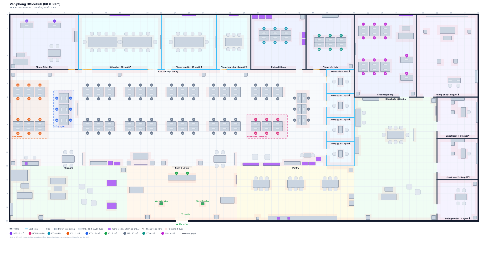

# Đề xuất văn phòng 3D — mặt bằng v1 và hướng làm

> Trạng thái: **đã duyệt** (2026-11-05, toàn bộ giả định mục 1). **Mặt bằng mục 2 đã được thay** bằng bản 50 × 30 m ngày 2026-11-06 — xem [office-1500m2-proposal.md](office-1500m2-proposal.md); các mục giả định / kỹ thuật / lộ trình vẫn đúng. **Giai đoạn 1 xong** (bản đồ `shared/office-map.json`, engine mới, va chạm FE + server, ngồi, minimap). Thay đổi so với bản vẽ đầu: cửa căn theo lưới 0,5 m, bàn Giám đốc dời ra để đi vào được. Chưa có bản vẽ văn phòng thật nên mặt bằng dưới đây do Claude đề xuất cho 6 phòng ban hiện có. Khi có văn phòng thật: sửa `shared/office-map.json`, chạy `bun design/tools/render-plan.ts` — phần code không phải đổi.

## 1. Giả định đang dùng (chưa được xác nhận)

| Câu hỏi | Giả định | Đổi thì ảnh hưởng gì |
|---|---|---|
| Mặt bằng | Một tầng 24 × 16 m (~384 m²), cửa chính phía nam | Chỉ sửa file JSON |
| Kiểu hình | Low-poly, **camera chéo cố định** (xoay được từng 90°), không bay tự do | Đổi sang góc nhìn thứ ba = viết lại camera + điều khiển |
| Thiết bị | **Laptop là chính**; điện thoại làm sau (giai đoạn 4) | Cần mobile sớm → thêm joystick ở giai đoạn 1 |
| Voice | Làm ở **giai đoạn 3** (sau khi văn phòng đi lại ổn) | Cần sớm → dựng LiveKit + TURN ngay giai đoạn 1 |

## 2. Mặt bằng đề xuất

| Khu | Vị trí | Vì sao |
|---|---|---|
| **Sảnh & Lễ tân** + máy chấm công | Ngay cửa chính | Vào văn phòng là gặp lễ tân; máy chấm công trên đường đi vào (giống văn phòng thật, nhắc chấm công) |
| **Khu nghỉ** (sofa, bàn game) và **Pantry** (bàn ăn 6 chỗ, cà phê) | Hai bên sảnh | Chỗ "gặp tình cờ" — lý do xã hội để mở văn phòng ảo; xa khu cần yên tĩnh |
| **Khu làm việc chung** | Giữa | Cụm bàn theo phòng ban: **Kỹ thuật** (6, góc tây xa sảnh, yên tĩnh), **Kinh doanh** (6, giữa), **HCNS** (4, gần máy in, gần sảnh để tiếp khách / ứng viên) |
| **Phòng Giám đốc** (2 bàn + sofa tiếp khách) | Góc tây-bắc, có tường | Riêng tư, xa cửa |
| **Phòng Kế toán** (4 bàn, tủ hồ sơ, két) | Phía bắc, có tường | Hồ sơ tài chính cần phòng kín |
| **Phòng họp lớn** (10 người, màn hình, bảng) và **phòng họp nhỏ** (4) | Phía bắc, vách kính | Kính = nhìn thấy phòng đang có người họp; mỗi phòng một kênh voice riêng |
| **2 phòng gọi** (2 người) | Góc đông khu làm việc | Gọi riêng 1–1, phỏng vấn, nói chuyện với HR |

**24 chỗ ngồi** cho 14 người hiện có → còn chỗ tăng lên ~20 người. Lối đi chính rộng ≥ 1,5 m (khu mở z 9,2–11) để avatar không kẹt.

### Gán chỗ ngồi đề xuất (tham khảo — không làm tính năng gán chỗ, xem giai đoạn 2 đã bỏ)

| Chỗ | Người | Chỗ | Người |
|---|---|---|---|
| BGD-01 | NV009 Đoàn Quang Huy | KD-01 | NV015 Hoàng Đức Long (trưởng phòng) |
| BGD-02 | NV010 Nguyễn Văn Thành | KD-02, KD-03 | NV016 Đặng Thu Trang, NV017 Bùi Quốc Bảo |
| HCNS-01 | NV011 Trần Thị Hạnh (trưởng phòng) | KTH-01 | NV018 Ngô Thanh Tùng (trưởng phòng) |
| HCNS-02 | NV012 Lê Thu Hà | KTH-02, KTH-03 | NV019 Đỗ Hải Nam, NV020 Mai Phương Anh |
| KT-01 | NV013 Phạm Minh Khoa (trưởng phòng) | LT-01 | NV001 Lễ Tân |
| KT-02 | NV014 Vũ Thị Lan | LT-02 | NV021 Phan Ngọc Mai |

Khi duyệt mặt bằng: đổi `departments.MapZone` từ `work` sang khu riêng (`dept-bgd`, `dept-hcns`, `dept-kt`, `dept-kd`, `dept-kth`; Lễ tân giữ `reception`).

## 3. Dữ liệu bản đồ v2 (`shared/office-map.json`)

Đơn vị mét, gốc (0,0) góc tây-bắc, x sang đông, z xuống nam. Một file dùng chung cho FE (vẽ) và Realtime (kiểm tra di chuyển) như bản v1.

| Phần | Nội dung |
|---|---|
| `floor`, `outerDoors`, `wallHeight`, `spawn` | Sàn, cửa chính, chiều cao tường, điểm xuất hiện |
| `rooms[]` | Hình chữ nhật có `kind` (office / meeting / booth / open / lounge / lobby / pantry), `zone`, `walls` (có tường hay khu mở), `glass`, `doors[]` (`side` n/s/e/w, `at` = khoảng cách từ góc, `w` = rộng), `capacity`, `voice: "room"` (vào phòng = vào kênh voice riêng) |
| `areas[]` | Khu của từng phòng ban trong khu mở (`dept`) — để biết "đang ở khu Kỹ thuật" |
| `seats[]` | Chỗ ngồi: `id` (KTH-01…), `dept`, `zone`, vị trí ghế, `facing` |
| `objects[]` | Đồ vật: `prefab`, tâm `x`/`z`, kích thước `w`×`d`, `rot`, `solid` (cản đường), `action` (`attendance.checkin`) hoặc `interact` (`screen`, `coffee`, `printer`, `game`, `notices`) |

**Lưới va chạm 0,5 m sinh ra khi tải** từ tường (trừ cửa) + đồ vật `solid` — không lưu trong JSON. FE dùng để tìm đường (A*, bấm đâu đi đó); Realtime dùng **cùng thuật toán** để chặn đi xuyên tường (hiện chỉ chặn ra ngoài sàn). Sửa bản đồ: sửa JSON → `bun design/tools/render-plan.ts` (vẽ lại `floor-plan.svg` + báo lỗi: ghế bị chắn, cửa bị chặn, ghế ngoài khu, id trùng…).

Đã thay bản v1 (2026-11-05): `shared/office-map.json` là v2, schema `shared/schemas/office-map.schema.json`, lưới va chạm của FE ghi ra `shared/office-map.grid.txt` để test server so sánh.

## 4. Hình ảnh & tài nguyên

- **Phong cách**: low-poly, màu nhạt theo theme app (sáng / tối), ánh sáng "nướng" sẵn (baked) + một đèn hướng → nhẹ máy.
- **Đồ đạc** (giai đoạn 1 dựng bằng khối hình học trong `engine/furniture.ts`, chưa dùng file model): bộ model **CC0** (dùng thương mại, không cần ghi công) dạng GLB — Kenney *Furniture Kit*, bổ sung KayKit / Quaternius nếu thiếu. Mỗi `prefab` trong JSON ánh xạ tới một file model; thiếu model thì vẽ hộp màu (như sơ đồ) để không chặn tiến độ.
- **Avatar**: nhân vật low-poly CC0 có sẵn animation đi / đứng / ngồi / vẫy tay; người dùng chọn màu áo, tóc. Trên đầu: tên + chấm trạng thái.
- **Ngân sách**: tải lần đầu trang `/office` ≤ ~3 MB (GLB nén Draco / meshopt, dùng chung texture), ≥ 30 FPS trên laptop card đồ hoạ tích hợp với 12 người online.

## 5. Kỹ thuật

- **Giữ Three.js thuần** (đúng quy ước hiện tại: engine không phụ thuộc React, React chỉ vẽ HUD). Tách `OfficeScene.ts` thành: `MapLoader` (JSON → lưới + mesh), `World` (tường, sàn, đồ vật — instancing cho bàn ghế giống nhau), `Avatars` (model + animation + nhãn), `Input` (WASD + bấm để đi), `NavGrid` (va chạm + A*), `CameraRig` (chéo, xoay 90°, zoom).
- **Realtime**: đọc bản đồ v2, kiểm tra ô đích không phải tường / đồ vật; thêm `Sit(seatId)` / `Stand()`, trạng thái (`Status`) và gom trạng thái HR (chấm công, nghỉ phép) qua Api theo chu kỳ — không gọi Api mỗi lần di chuyển.
- **Voice (giai đoạn 3)**: LiveKit (đã có endpoint cấp token). Khu mở: âm thanh theo khoảng cách (gần nghe rõ, > ~6 m tắt). Phòng có `voice: "room"`: vào phòng = vào kênh riêng, người ngoài không nghe. Cần LiveKit server + TURN trên VPS.

## 6. Lộ trình

| Giai đoạn | Làm gì | Xong khi |
|---|---|---|
| **1. Thế giới** ✅ | Engine mới theo mục 5; dựng mặt bằng v2; tường, cửa, đồ vật; va chạm FE + server; bấm để đi + WASD; bản đồ nhỏ; avatar có animation; ngồi vào chỗ của mình (phím E) | Đi lại tự nhiên trong văn phòng, không xuyên tường, ngồi được |
| ~~**2. Hiện diện**~~ ✕ | **Bỏ** — chủ dự án quyết định không cần (2026-11-05): gán chỗ ngồi, trạng thái trên đầu avatar, "tìm đồng nghiệp", người offline hiện mờ tại bàn | — |
| **3. Giao tiếp** ✅ (trừ chat theo phòng) | Voice theo khoảng cách + phòng họp / phòng gọi có kênh riêng, chia sẻ màn hình trong phòng họp; chat theo phòng | Họp và trao đổi nhanh ngay trong văn phòng ảo |
| **4. Mở rộng** | Trang sửa mặt bằng cho admin (kéo thả bàn ghế), đặt phòng họp, tuỳ chỉnh avatar, mobile | Tuỳ nhu cầu |

## 7. Cần chủ dự án xác nhận

1. Bố cục: vị trí các phòng ban, phòng Giám đốc 2 bàn, Kế toán phòng kín — có đúng cách công ty làm việc không?
2. Các giả định ở mục 1 (kiểu camera, laptop trước, voice ở giai đoạn 3).
3. Tên phòng họp (đặt tên riêng, vd "Phòng Hà Nội" / "Phòng Sài Gòn"?) và logo công ty cho tường sảnh.
4. Bảng gán chỗ ngồi ở mục 2.
