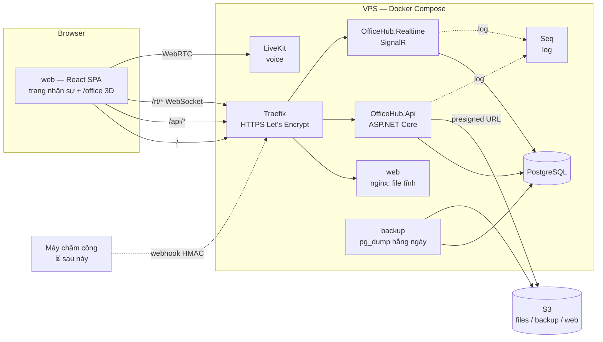

# Kiến trúc V2: Văn phòng ảo 3D + Quản lý nhân sự nội bộ

> **Cập nhật theo code: 2026-11-05.** Back-end **ASP.NET Core (.NET 10)**, front-end **React 19 + Vite (bun)**.
> Ký hiệu: ✅ đã có trong code · ⏳ thiết kế, chưa code.
> Cách chạy, cách điền key: [.agent/commands.md](../.agent/commands.md).
> [ARCHITECTURE.md](ARCHITECTURE.md) và [PLAN_FE_BE.md](PLAN_FE_BE.md) là tài liệu cũ của hướng "game", chỉ còn để tham khảo phần dựng 3D.

---

## 0. Trạng thái hiện tại

| Hạng mục | Trạng thái |
|---|---|
| Cấu hình tập trung trong `.env`, báo thiếu key khi khởi động, `/health/ready` kiểm tra DB / S3 / SMTP | ✅ |
| Đăng nhập bằng email hoặc tên đăng nhập, cookie dùng chung giữa Api và Realtime, đổi mật khẩu bắt buộc, khoá 15 phút sau 5 lần sai | ✅ |
| Tự chạy migration, tự tạo admin đầu tiên từ `.env` | ✅ |
| **Văn phòng 3D giai đoạn 1**: mặt bằng v2 (24 × 16 m, 10 phòng, 24 chỗ ngồi theo phòng ban, `design/`), engine mới (camera chéo xoay 90°, đồ đạc low-poly, avatar đi / ngồi), va chạm + tìm đường A* (lưới dùng chung FE / server, server chặn xuyên tường), ngồi ghế, bản đồ nhỏ; chat, chống teleport, một tài khoản một tab | ✅ |
| Voice LiveKit: kênh theo vị trí (server chọn), khu mở theo khoảng cách, phòng họp + chia sẻ màn hình | ✅ |
| Front-end feature-based: đăng nhập, đổi mật khẩu, layout nhân sự, `/office` lazy load | ✅ |
| **Organization**: phòng ban, chức vụ, hồ sơ nhân viên, HR cấp tài khoản (mời qua email / mật khẩu tạm), đổi vai trò, nghỉ việc / khôi phục | ✅ |
| **Identity**: quên mật khẩu, nhận lời mời qua email (link 72 giờ), giới hạn tần suất đăng nhập | ✅ |
| **Attendance**: nút chấm công (web + văn phòng 3D), ca cố định / linh hoạt, lịch tuần (công ty + riêng từng người), ngày lễ, bảng công tháng, bảng hôm nay, tổng hợp tháng | ✅ |
| **Approval**: luồng duyệt dùng chung quản lý → HR, không tự duyệt, hộp "Chờ tôi duyệt" + badge menu, từ chối bắt buộc lý do, người gửi huỷ được | ✅ |
| **Leave**: 4 loại phép, quỹ phép năm (12 ngày + thâm niên, cộng dồn tháng, **không hết hạn**), đơn cả ngày / nửa ngày, xem trước số ngày, lịch nghỉ team, HR điều chỉnh quỹ phép | ✅ |
| **Giải trình chấm công**: bổ sung giờ vào / ra trong 31 ngày gần nhất, duyệt xong bảng công tự đúng; bảng công hiện "Nghỉ phép" | ✅ |
| Khoá tài khoản có hiệu lực ngay (Api kiểm tra security stamp mọi request; văn phòng 3D đẩy người bị khoá ra ≤ 30 giây) | ✅ |
| SMTP: timeout 15 giây, tuỳ chọn `Smtp__CheckCertificateRevocation` (mặc định bật) | ✅ |
| **Notification**: chuông in-app + email (hàng đợi trong DB, thử lại 5 lần, bỏ qua tên miền thử nghiệm) cho gửi / duyệt / từ chối / huỷ đơn | ✅ |
| **LaborContracts**: hợp đồng (vô thời hạn / có thời hạn ≤ 36 tháng / thử việc ≤ 180 ngày), phụ lục, lương mã hoá AES-GCM, file S3, nhắc HR + quản lý 30 / 7 ngày; nhân viên xem của mình | ✅ |
| Reporting, Audit: khung project + `/_status` | ✅ khung · ⏳ nghiệp vụ |
| Docker image (api, realtime, web), compose production, backup S3, CI GitHub Actions | ✅ (chưa deploy thật) |
| Test: kiến trúc (module không tham chiếu chéo) + bộ tính công + quy tắc phép năm (29 test) | ✅ |
| Wolverine (sự kiện/outbox), Hangfire (job), Audit interceptor | ⏳ |
| **Tăng ca**: đăng ký trước / khai bù 7 ngày, duyệt quản lý → HR, tính theo giờ trên đơn, tách 150 / 200 / 300% theo loại ngày, cảnh báo 40 giờ/tháng · 200 giờ/năm | ✅ |
| Nhắc quên chấm ra, quy ra tiền tăng ca | ⏳ |
| Quy ra tiền phép năm (UI hiện "Đang phát triển") | ⏳ |
| Engine 3D đầy đủ (viết mới), dựng theo mặt bằng thật | ⏳ |

---

## 1. Bối cảnh và yêu cầu đã chốt

| Yếu tố | Đã chốt | Ảnh hưởng tới thiết kế |
|---|---|---|
| Người dùng | Công ty của chính bạn, dùng nội bộ | Một tổ chức (single-tenant), không có `tenant_id`, không làm quản trị SaaS |
| Địa điểm | Một văn phòng, không có chi nhánh | Công ty → phòng ban → nhân viên. Một dải IP văn phòng |
| Quy mô | **12 nhân sự** | VPS 2 vCPU / 4 GB là đủ. Luồng duyệt ngắn (quản lý → HR) |
| Hình thức làm việc | Từ xa và tại văn phòng đều được, **không cần đăng ký/duyệt** | Mỗi lượt chấm công tự ghi *tại văn phòng* / *từ xa* theo IP |
| Cách chấm công | **Bấm nút chủ động** (vào/ra) | Vào văn phòng 3D không tự chấm công |
| Ca làm | **Cả cố định lẫn linh hoạt** | Gán theo nhân viên × ngày trong tuần (mục 6.2) |
| Nguồn chấm công | Văn phòng 3D / web; **sau này thêm webhook máy chấm công** | Mọi nguồn đổ về một bảng sự kiện chung |
| Tài khoản | **Email cá nhân**, hoặc **HR tạo tài khoản** | ASP.NET Core Identity; không phụ thuộc Google/Microsoft |
| Hạ tầng | **VPS riêng** | Docker Compose, Traefik HTTPS, không dùng Kubernetes |
| File | **S3** | Hợp đồng, hồ sơ, avatar, bản build FE, bản sao lưu DB |
| Công nghệ | **Back-end ASP.NET, front-end ReactJS** | Mục 10 |

### Chức năng

| Nhóm | Chức năng |
|---|---|
| **Tổ chức** | Phòng ban (cây nhiều cấp), chức vụ, quản lý trực tiếp, hồ sơ nhân viên, nhập từ Excel |
| **Tài khoản** | HR tạo nhân viên → mời qua email **hoặc** cấp tên đăng nhập + mật khẩu tạm; đổi mật khẩu lần đầu; quên mật khẩu; 2FA |
| **Chấm công** | Ca làm, nút chấm công (3D / web), webhook máy chấm công, đi muộn, về sớm, tăng ca, giải trình |
| **Nghỉ phép** | Loại phép, chính sách cộng phép, quỹ phép, đơn nghỉ, lịch nghỉ cả phòng |
| **Hợp đồng** | Loại hợp đồng, phụ lục, mẫu, file S3, nhắc sắp hết hạn |
| **Phê duyệt** | Luồng duyệt dùng chung: nghỉ phép, giải trình, tăng ca, hợp đồng |
| **Văn phòng ảo** | Mặt bằng theo văn phòng thật, chỗ ngồi theo phòng ban, trạng thái, chat, phòng họp, voice |
| **Báo cáo** | Bảng công tháng, tổng hợp phép, xuất Excel |
| **Gamification** (tuỳ chọn) | KPI, điểm, chức danh vui từ bản game |

---

## 2. Nguyên tắc thiết kế

1. **Dữ liệu nhân sự là dữ liệu pháp lý.** Transaction, ràng buộc ngay trong DB, xoá mềm, audit log.
2. **Sự kiện chấm công thô không bao giờ sửa.** Mọi nguồn chỉ *thêm* sự kiện; bảng công được tính lại từ sự kiện.
3. **Luật lao động là cấu hình.** Có giá trị mặc định theo Bộ luật Lao động 2019, HR tự chỉnh.
4. **Ranh giới module rõ, deploy ít khối.** Mỗi module là một project .NET. Test kiến trúc chặn tham chiếu chéo.
5. **Server quyết định.** Thời gian chấm công, vị trí trong 3D, quyền truy cập đều do server kiểm tra. Front-end chỉ điều hướng.
6. **Mọi cấu hình nằm trong `.env`.** Thiếu key thì app dừng và báo đúng tên biến.
7. **Vừa một VPS.** Mỗi thành phần thêm vào phải đáng với RAM và công vận hành.

---

## 3. Tổng quan hệ thống



### Định tuyến (production cùng một domain)

| Đường dẫn | Tới | Ghi chú |
|---|---|---|
| `/`, `/office`, `/leave`, … | `web` (nginx) | SPA, mọi đường dẫn trả `index.html` |
| `/api/*` | `OfficeHub.Api` | REST, cookie đăng nhập |
| `/rt/hub/office` | `OfficeHub.Realtime` | SignalR (WebSocket, MessagePack) |
| `/rt/voice/token` | `OfficeHub.Realtime` | Cấp token LiveKit |
| `VOICE_DOMAIN` | LiveKit | WebRTC (UDP trực tiếp) |

Cùng một domain nên cookie đăng nhập dùng chung, không cần CORS.

### Cổng khi dev

| Dịch vụ | Cổng |
|---|---|
| Front-end (Vite, proxy `/api` và `/rt`) | 5173 |
| OfficeHub.Api | 5080 |
| OfficeHub.Realtime | 5090 |
| Postgres / S3 giả lập (RustFS) / Mailpit / Seq / LiveKit | 5432 / 9000–9001 / 1025, 8025 / 5341 / 7880 |

---

## 4. Back-end

### 4.1 Solution

```
backend/
├── OfficeHub.slnx
├── global.json                    # .NET SDK 10
├── Directory.Build.props          # net10.0, nullable, implicit usings
├── dotnet-tools.json              # dotnet-ef
├── Dockerfile                     # build Api hoặc Realtime (--build-arg SERVICE=...)
├── src/
│   ├── OfficeHub.Api/             # host REST: nạp danh sách module
│   ├── OfficeHub.Realtime/        # host SignalR: Hubs/, Simulation/, Voice/
│   ├── BuildingBlocks/OfficeHub.BuildingBlocks/   # + Auth/AuthPolicies (hr, manager), Http/Validation (lỗi theo field)
│   │   ├── Configuration/         # EnvLoader (.env), Settings (App, S3, Smtp, Office, DataProtection), AddValidatedOptions
│   │   ├── Hosting/               # AddOfficeHubDefaults: Serilog→Seq, Sentry, DataProtection, ForwardedHeaders, ProblemDetails
│   │   ├── Health/                # /health, /health/ready (Postgres, S3, SMTP)
│   │   ├── Auth/                  # AuthCookie (cookie dùng chung), Roles, ClaimNames
│   │   ├── Modules/               # IModule
│   │   ├── Persistence/           # AddModuleDbContext (schema riêng + bảng migration riêng)
│   │   ├── Storage/               # IFileStorage → S3FileStorage (presigned URL)
│   │   ├── Email/                 # IEmailSender → SmtpEmailSender (MailKit)
│   │   └── Office/                # OfficeNetwork: IP thuộc văn phòng hay không
│   └── Modules/
│       ├── Identity/              # ✅  + Identity.Contracts (IAccountService)
│       ├── Organization/          # ✅  + Organization.Contracts (IEmployeeDirectory)
│       ├── Attendance/            # ✅
│       └── Leave/ Approval/ Notification/ LaborContracts/ ✅ · Reporting/ Audit/   # khung
└── tests/
    ├── OfficeHub.Architecture.Tests/       # module không tham chiếu chéo
    └── OfficeHub.Modules.Attendance.Tests/ # 12 test cho bộ tính công
```

### 4.2 Hai host

| Host | Chứa gì | Vì sao tách |
|---|---|---|
| **`OfficeHub.Api`** | REST cho toàn bộ nghiệp vụ, OpenAPI (`/openapi/v1.json`), Scalar UI (`/scalar`, chỉ khi dev); ⏳ job nền, webhook máy chấm công | Nghiệp vụ dính nhau, chung một process thì giao dịch đơn giản và đúng |
| **`OfficeHub.Realtime`** | SignalR hub `/rt/hub/office`, vòng lặp 10 Hz, token voice | Giữ kết nối lâu. Deploy lại `Api` không làm rớt người đang trong văn phòng |

**Cookie dùng chung:**
- `Api` cấp cookie (`officehub.auth`, scheme `Identity.Application`), `Realtime` đọc lại cookie đó.
- Điều kiện để đọc được: hai host dùng **cùng scheme**, **cùng tên cookie** và **cùng thư mục khoá DataProtection** (`DataProtection__KeysPath`, application name `OfficeHub`).

### 4.3 Module: mẫu và quy ước

Mỗi module triển khai `IModule`:

```csharp
public interface IModule
{
    string Name { get; }                                          // tiền tố route: /api/{Name}
    void Register(IServiceCollection services, IConfiguration config);
    void MapEndpoints(IEndpointRouteBuilder api);
}
```

`OfficeHub.Api/Program.cs` chỉ liệt kê các module. Thêm module mới thì thêm một dòng vào danh sách.

```
Modules/<M>/OfficeHub.Modules.<M>/
├── Domain/            # entity, quy tắc nghiệp vụ
├── Features/          # vertical slice: mỗi use case một thư mục (Endpoint + Handler + Validator)
├── Infrastructure/    # DbContext (schema riêng), Configurations/, Migrations/
├── Contracts/         # sự kiện, interface công khai
└── <M>Module.cs
```

**Quy tắc ranh giới (test kiến trúc kiểm tra trong CI):**
- Module **không tham chiếu project của module khác**.
- Khi module A cần dùng phần công khai của module B: tách thành project `OfficeHub.Modules.B.Contracts`. Test cho phép tham chiếu tới project có hậu tố `.Contracts`.
  - Vì quy ước này, module hợp đồng lao động tên là **`LaborContracts`**, không phải `Contracts`.
- `Realtime` không tham chiếu module nghiệp vụ.
- Mỗi module một `DbContext`, **một schema Postgres riêng**, không JOIN chéo schema.
- **Không dùng MediatR / AutoMapper / MassTransit** vì đã chuyển sang license thương mại. ⏳ Dùng Wolverine (MIT) cho handler và sự kiện.

### 4.4 Danh sách module

| Module | Route | Schema | Trạng thái | Trách nhiệm |
|---|---|---|---|---|
| `Identity` | `/api/auth` | `identity` | ✅ | Tài khoản, đăng nhập, mật khẩu, vai trò |
| `Organization` | `/api/org` | `org` | ✅ | Phòng ban, chức vụ, nhân viên, cấp tài khoản cho nhân viên |
| `Attendance` | `/api/attendance` | `attendance` | ✅ | Chấm công, ca làm, lịch tuần, ngày lễ, bảng công, giải trình, tăng ca · ⏳ webhook máy |
| `Leave` | `/api/leave` | `leave` | ✅ | Loại phép, quỹ phép năm, đơn nghỉ, điều chỉnh của HR |
| `LaborContracts` | `/api/contracts` | `contracts` | ✅ | Hợp đồng, phụ lục, lương mã hoá, file S3, nhắc hết hạn · ⏳ mẫu hợp đồng, ký điện tử |
| `Approval` | `/api/approval` | `approval` | ✅ | Luồng duyệt dùng chung (nghỉ phép, giải trình) |
| `Notification` | `/api/notifications` | `notifications` | ✅ | Chuông in-app, email gửi nền (hàng đợi trong DB) |
| `Reporting` | `/api/reports` | (đọc qua view) | khung | Bảng công tháng, xuất Excel |
| `Audit` | `/api/audit` | `audit` | khung | Lịch sử thay đổi dữ liệu nhân sự |

Module khung hiện chỉ có `GET /api/<route>/_status` (cần đăng nhập).

### 4.5 Identity ✅

**Endpoint:**

| Method | Đường dẫn | Mô tả |
|---|---|---|
| POST | `/api/auth/login` | `{ login, password, rememberMe }`. `login` là email **hoặc** tên đăng nhập. Trả `MeResponse`, đặt cookie |
| POST | `/api/auth/logout` | Xoá cookie |
| GET | `/api/auth/me` | `{ id, userName, email, fullName, roles[], mustChangePassword }`; 401 nếu chưa đăng nhập |
| POST | `/api/auth/change-password` | `{ currentPassword, newPassword }`. Thành công thì bỏ cờ `MustChangePassword` và cấp lại cookie |
| POST | `/api/auth/forgot-password` | `{ email }` → gửi link đặt lại mật khẩu. Luôn trả 204 (không tiết lộ email có tồn tại hay không) |
| POST | `/api/auth/reset-password` | `{ userId, token, newPassword }`: dùng chung cho **link mời** (`/accept-invite`) và **link quên mật khẩu** (`/reset-password`). Token dùng một lần, hết hạn 72 giờ |

Đăng nhập, quên mật khẩu và đặt mật khẩu bị giới hạn **30 request/phút theo IP + endpoint**. Hạn mức này đủ rộng vì cả văn phòng dùng chung một IP public.

**`IAccountService`** (project `Identity.Contracts`): module khác dùng để tạo tài khoản (mật khẩu tạm / mời qua email), gửi lại lời mời, cấp lại mật khẩu tạm, đổi vai trò, khoá / mở khoá. Đổi vai trò hoặc khoá tài khoản sẽ đổi security stamp, làm cookie cũ mất hiệu lực.

**Quy tắc:**
- Mật khẩu: tối thiểu 8 ký tự, có chữ số và chữ thường.
- Khoá 15 phút sau 5 lần đăng nhập sai.
- Tài khoản bị tắt (`IsActive = false`) thì không đăng nhập được.
- Lỗi trả theo chuẩn **ProblemDetails**: 401 sai thông tin, 423 bị khoá, 403 + `title: "2fa_required"` khi cần 2FA.

**Dữ liệu:**
- `AppUser : IdentityUser<Guid>`, thêm `FullName`, `MustChangePassword`, `IsActive`, `CreatedAt`, `LastLoginAt`.
- Email **không bắt buộc**, nhưng nếu có thì phải duy nhất (unique index lọc giá trị NULL).

**Cookie** chứa thêm claim `full_name`, và `must_change_password` khi đang dùng mật khẩu tạm. Realtime dùng các claim này để hiện tên trên avatar và từ chối kết nối khi người dùng chưa đổi mật khẩu.

**Khởi động** (`IdentitySeeder`):
1. Chạy migration (nếu `Database__MigrateOnStartup=true`).
2. Tạo 4 vai trò: `admin`, `hr`, `manager`, `employee`.
3. Nếu chưa có admin: tạo từ `Seed__AdminEmail` / `Seed__AdminPassword` với vai trò `admin` + `hr`. Thiếu hai key này thì dừng và báo lỗi.

**⏳ Còn thiếu:** 2FA TOTP (bắt buộc với admin/hr), chống CSRF cho request ghi dữ liệu.

### 4.6 Organization ✅

| Method | Đường dẫn | Quyền | Mô tả |
|---|---|---|---|
| GET | `/api/org/employees?search=&departmentId=&status=&includeResigned=` | đăng nhập | Danh bạ. Thông tin tài khoản chỉ trả cho HR |
| GET | `/api/org/employees/{id}` · `/me` · `/next-code` | đăng nhập · đăng nhập · HR | Chi tiết / hồ sơ của tôi / mã tiếp theo (NV001…) |
| POST · PUT | `/api/org/employees` · `/{id}` | HR | Thêm / sửa. Kiểm tra: mã và email không trùng, quản lý không tạo vòng lặp |
| POST | `/api/org/employees/{id}/resign` · `/reactivate` | HR | Nghỉ việc: khoá tài khoản, gỡ khỏi vai trò quản lý / trưởng phòng; khôi phục: mở khoá |
| POST | `/api/org/employees/{id}/account` | HR | `{ mode: invite \| password, userName?, roles[] }`. Mật khẩu tạm 10 ký tự chỉ trả về **một lần** |
| POST · PUT | `/api/org/employees/{id}/account/resend-invite` · `reset-password` · `roles` | HR | Gửi lại lời mời / cấp lại mật khẩu tạm / đổi vai trò |
| GET · POST · PUT · DELETE | `/api/org/departments` · `/api/org/positions` | đọc: đăng nhập; ghi: HR | Không xoá được khi còn nhân viên hoặc còn phòng ban con. Phòng ban gắn `mapZone` (khu vực trên bản đồ 3D) |

**Quy tắc phân quyền vai trò:** chỉ **admin** được cấp vai trò admin, đổi vai trò hoặc đặt lại mật khẩu của một admin. Admin không tự gỡ được vai trò admin của chính mình.

**`IEmployeeDirectory`** (project `Organization.Contracts`) cho phép module khác:
- tìm nhân viên theo tài khoản;
- liệt kê nhân viên đang làm;
- lấy danh sách cấp dưới (trực tiếp và gián tiếp);
- lấy ngày vào làm và ngày nghỉ việc.

### 4.7 Attendance ✅

| Method | Đường dẫn | Quyền | Mô tả |
|---|---|---|---|
| GET | `/api/attendance/today` | nhân viên | Trạng thái hôm nay, ca, các phiên, hình thức sẽ ghi nhận (theo IP hiện tại) |
| POST | `/api/attendance/check` | nhân viên | `{ source: web \| office3d }`. Đổi trạng thái vào ↔ ra. Giờ server, ghi IP / user-agent. Bấm lại trong 1 phút thì trả 409 |
| GET | `/api/attendance/my?month=yyyy-MM` | nhân viên | Bảng công tháng của tôi + tổng hợp |
| GET | `/api/attendance/employees/{id}?month=` · `/board?date=` · `/report?month=` | quản lý (cấp dưới) / HR (tất cả) | Bảng công một người / tình trạng trong ngày / tổng hợp tháng |
| GET · POST · PUT · DELETE | `/api/attendance/shifts` | đọc: đăng nhập; ghi: HR | Ca cố định / linh hoạt. Không xoá được ca đang nằm trong lịch |
| GET · PUT · DELETE | `/api/attendance/schedules` | HR | Lịch tuần (7 ngày → ca / nghỉ) cho công ty hoặc từng người, hiệu lực từ một ngày |
| GET · POST · DELETE | `/api/attendance/holidays` | đọc: đăng nhập; ghi: HR | Ngày lễ |

- Tài khoản chưa gắn hồ sơ nhân viên (ví dụ admin hệ thống) gọi chấm công thì nhận **409** với `title: "no_employee_profile"`.
- Lần chạy đầu, hệ thống tạo sẵn ca **"Hành chính" 08:30–17:30** (nghỉ trưa 12:00–13:30, cho phép trễ 5 phút), ca **"Linh hoạt 8 tiếng"** (vào 07:00–10:00), và lịch công ty **thứ 2–6 làm ca Hành chính**.

### 4.8 Approval & Leave ✅ (tóm tắt — chi tiết ở `.agent/business/approval.md`, `leave.md`)

- **Approval** nhận đơn qua `IApprovalService.SubmitAsync` với các bước `[Manager, Hr]`. Module sở hữu đơn nhận kết quả qua `IApprovalHandler` (phải idempotent). Thứ tự quyết định: cập nhật bước → gọi handler → lưu (handler lỗi thì đơn vẫn ở bước cũ, duyệt lại được).
- **Leave** đếm số ngày nghỉ bằng `IWorkCalendar` (chỉ ngày có ca, bỏ ngày lễ). Attendance đọc ngày nghỉ đã duyệt qua `ILeaveCalendar` để hiện "Nghỉ phép". Quỹ phép **tính khi đọc** từ ngày vào làm + đơn đã duyệt + điều chỉnh, không lưu sẵn.
- Module gọi nhau **đồng bộ qua `*.Contracts`** (chưa có Wolverine / outbox).

### 4.9 Realtime ✅

**Hub** `/rt/hub/office` (`[Authorize]`, MessagePack):

| Hướng | Thông điệp | Nội dung |
|---|---|---|
| server → client | `Welcome` | `selfId`, `mapName`, danh sách người đang online |
| server → client | `PlayerJoined` / `PlayerLeft` | Người vào / ra |
| server → client | `Positions` | Gói vị trí đã thay đổi, 10 lần/giây |
| server → client | `Chat` | `{ id, name, text, at }` |
| server → client | `Teleport` | Kéo client về vị trí hợp lệ |
| server → client | `Kicked` | Tài khoản vừa mở ở tab hoặc thiết bị khác |
| client → server | `Move(x, z, r, anim)` | Server kiểm tra trong sàn và tốc độ ≤ `7·dt + 2.5` |
| client → server | `SendChat(text)` | Tối đa 200 ký tự, 1 tin/giây |

**Quy tắc:**
- **Một tài khoản chỉ một kết nối.** Kết nối cũ nhận `Kicked` rồi bị ngắt sau 500ms. Client nhận `Kicked` sẽ không tự kết nối lại.
- Bản đồ đọc từ `shared/office-map.json` (đường dẫn qua `Realtime__MapPath`). Front-end dùng chung file này để vẽ.
- Trạng thái chỉ nằm trong RAM (`Presence`), không lưu Postgres.

**Voice:** `POST /rt/voice/token` trả `{ url, token, room, channel, meeting }` — room do server chọn theo vị trí (chi tiết `.agent/business/office.md`).
- Cần `LiveKit__*`. Secret ngắn hơn 32 ký tự thì app không khởi động.
- Không cấu hình thì trả 503.

**⏳ Còn thiếu:** port logic va chạm / ngồi / vùng từ MVP, trạng thái "Vắng", phát sự kiện presence sang Attendance (qua Wolverine). (Chọn phòng voice theo vị trí ✅.)

---

## 5. Front-end ✅

**Công cụ:** React 19 + Vite + TypeScript, chạy bằng **bun**. Kiến trúc **feature-based**.

```
frontend/
├── index.html  vite.config.ts  tsconfig.json  components.json (shadcn)  orval.config.ts
├── Dockerfile  nginx.conf  .env.example
├── public/favicon.svg
├── scripts/upload-web-s3.sh                 # đẩy dist lên S3 bucket web (lưu bản / rollback)
└── src/
    ├── assets/            icons/  images/  styles/global.css   # Tailwind v4 + theme shadcn (CSS variables)
    ├── components/
    │   ├── common/        shadcn: button, input, label, card, dialog, alert-dialog, table, tabs, badge, select,
    │   │                  dropdown-menu, textarea, sonner · FormField, SelectField
    │   ├── feedback/      Spinner, ComingSoon
    │   └── layout/        MainLayout (sidebar), navigation.ts (menu lọc theo role)
    ├── config/            env.ts (ENV, REALTIME, STORAGE_KEY) · paths.ts (PATHS) · roles.ts (ROLE) · theme.ts (màu cho canvas/3D)
    ├── context/           (chưa có)
    ├── features/
    │   ├── auth/          api/auth.api.ts · components/(LoginForm, ChangePasswordForm, AuthShell)
    │   │                  hooks/(useAuth: meQuery, useMe, useLogin, useChangePassword · useLogout)
    │   │                  types/auth.types.ts · utils/(safeReturnPath, hasRole) · index.ts
    │   ├── office/        api/officeHub.ts (SignalR) · components/(OfficeView, office.css) · engine/OfficeScene.ts (Three.js)
    │   │                  store/office.store.ts (Zustand) · types/office.types.ts · index.ts
    │   ├── employees/     ✅ api/org.api.ts · hooks/useOrg.ts · components/(EmployeesPage, EmployeeTable, EmployeeFormDialog,
    │   │                  AccountDialogs, DepartmentsPanel, PositionsPanel) · types · utils/labels · index.ts
    │   ├── attendance/    ✅ api · hooks/useAttendance (useToday, useCheck…) · components/(AttendancePage, CheckInCard,
    │   │                  MonthTimesheet, TeamTables, ShiftsPanel, SchedulesPanel, HolidaysPanel) · types · utils · index.ts
    │   ├── dashboard/     components/Dashboard (dùng CheckInCard) · index.ts
    │   ├── approvals/     ✅ ApprovalsPage, ApprovalCard (duyệt / từ chối / huỷ), useInboxCount (badge menu)
    │   ├── leave/         ✅ LeavePage, BalanceCards, LeaveRequestDialog, LeaveTables (của tôi / lịch nghỉ / quỹ phép)
    │   └── contracts/ reports/   # components/<Page> (ComingSoon) · index.ts
    ├── hooks/             useDebounce
    ├── routes/            router.tsx (khai báo route, lazy load) · guards.ts (requireAuth, requireSession, guestOnly)
    ├── services/          api-client.ts (fetch + cookie + ApiError theo ProblemDetails)
    ├── types/             api.ts · generated/ (bun run api:generate → sinh từ OpenAPI)
    ├── utils/             cn.ts · date.ts (giờ Việt Nam) · errors.ts (fieldErrors, errorMessage từ ProblemDetails)
    ├── App.tsx            QueryClientProvider + RouterProvider
    └── main.tsx
```

### Quy ước

- **Bên ngoài một feature chỉ import qua `@/features/<x>`** (file `index.ts`). Bên trong feature dùng đường dẫn tương đối.
- Feature được thêm thư mục riêng khi cần. Ví dụ `office` có `engine/` và `store/`.
- Đăng nhập bằng cookie HttpOnly do server cấp, nên **không có token-service**. `api-client.ts` luôn gửi `credentials: 'include'`.
- Query key đặt trong `api/` của từng feature, ví dụ `authKeys.me`.
- shadcn/ui đặt trong `components/common/`. Thêm component bằng `bunx shadcn@latest add <tên>` (alias đã cấu hình trong `components.json`).
- Hằng số dùng chung (đường dẫn, vai trò, endpoint realtime) nằm trong `config/`.

### Định tuyến

TanStack Router khai báo bằng code trong `routes/router.tsx`. Mọi màn hình được lazy load: mỗi feature là một file JS riêng, trong lúc tải hiện `Spinner`.

```
root
├── /login              guestOnly          → features/auth LoginForm
├── /forgot-password    guestOnly          → features/auth ForgotPasswordForm
├── /accept-invite      (link trong email) → features/auth AcceptInviteForm
├── /reset-password     (link trong email) → features/auth ResetPasswordForm
├── /change-password    requireSession     → features/auth ChangePasswordForm
└── (protected)         requireAuth        # chưa đăng nhập → /login?returnUrl=…; mật khẩu tạm → /change-password
    ├── /office                            → features/office (toàn màn hình; kéo theo Three.js + SignalR)
    └── (main) MainLayout + sidebar
        ├── /            Dashboard
        ├── /attendance  /leave  /approvals  /employees  /contracts  /reports
```

- Quay lại trang cũ sau khi đăng nhập dùng `returnUrl`. `safeReturnPath` chỉ cho phép đường dẫn nội bộ.
- Menu sidebar lọc theo vai trò (`navigation.ts`). Server vẫn là nơi kiểm tra quyền thật.

**Thêm một màn hình:**
1. Tạo `features/<x>/` (+ `index.ts`).
2. Thêm đường dẫn vào `config/paths.ts`.
3. Thêm một dòng `page(...)` trong `routes/router.tsx`.
4. Thêm menu trong `components/layout/navigation.ts`.

### Văn phòng 3D

- `OfficeScene` là Three.js thuần, không phụ thuộc React: sàn, các vùng, avatar dạng capsule có nhãn tên, đi bằng WASD, camera bám theo người chơi.
- Các phần nối với nhau qua store Zustand:
  - `OfficeView` (React) dựng HUD: tên, số người online, vùng hiện tại, chat, nút chấm công (đang tắt).
  - `officeHub.ts` lo kết nối SignalR.
- CSS gói trong `.office-root` để không ảnh hưởng các trang nhân sự.
- **⏳** Viết mới avatar, đồ đạc, va chạm, ngồi, joystick mobile (code MVP cũ đã được xoá có chủ ý), rồi dựng theo mặt bằng thật.

### Build

| Chunk | Kích thước (gzip) | Tải khi |
|---|---|---|
| `index` (React, Router, Query, layout, auth) | ~118 KB | Luôn |
| Mỗi màn hình nhân sự | < 2 KB | Mở màn hình đó |
| `office` | ~26 KB | Vào `/office` |
| `three` | ~134 KB | Vào `/office` |

---

## 6. Chấm công ✅ (webhook máy ⏳)

### 6.1 Mọi nguồn đổ về một chỗ

```
 Nút chấm công (3D / web) ──┐
 Webhook máy chấm công ─────┼──▶ attendance_events (chỉ thêm) ──▶ Bộ tính công ──▶ timesheets (người × ngày)
 Giải trình đã duyệt ───────┘                                       ▲ tính lại khi có sự kiện mới,
                                                                    │ đổi ca, duyệt đơn nghỉ
```

**`attendance_events`:**

| Cột | Ghi chú |
|---|---|
| `employee_id`, `occurred_at` | Giờ server |
| `type` | `check_in` / `check_out` |
| `source` | `office3d` / `web` / `device` / `manual` |
| `work_mode` | `onsite` / `remote`. Máy chấm công → `onsite`; 3D/web → so IP với `Office__IpRanges` (`OfficeNetwork` ✅ đã có) |
| `ip`, `user_agent`, `device_id`, `raw` (JSONB) | Bằng chứng khi đối soát |
| `idempotency_key` UNIQUE | Chống ghi trùng |

**Bảng công không lưu sẵn: tính trực tiếp mỗi lần xem.**
- Database chỉ lưu bảng `attendance.events`. Mỗi lần xem, `AttendanceService` lấy sự kiện + lịch + ngày lễ rồi gọi `TimesheetCalculator`.
- `TimesheetCalculator` là hàm thuần, có 12 unit test.
- Với 12 người, cách này nhanh, luôn đúng theo ca và ngày lễ hiện hành, không cần job chạy nền.
- Khi cần "chốt công" theo tháng, sẽ lưu snapshot sau.

Trạng thái ngày: `Present` (đủ cặp vào/ra), `Working` (đang làm), `MissingCheckout` (ngày đã qua còn phiên mở, phiên đó không tính giờ), `Absent`, `NotYet`, `DayOff`, `Holiday`, `NotEmployed` (trước ngày vào làm / sau ngày nghỉ việc).

**Bộ tính công** cho ra mỗi ngày:
- giờ vào đầu tiên, giờ ra cuối cùng;
- phút đi muộn, về sớm / thiếu giờ;
- tổng giờ (cộng các cặp vào → ra), giờ tăng ca;
- hình thức: tại văn phòng / từ xa / kết hợp.

### 6.2 Ca làm: cố định + linh hoạt

| | Ca cố định (`fixed`) | Ca linh hoạt (`flexible`) |
|---|---|---|
| Cấu hình | Giờ vào/ra, nghỉ trưa, số phút cho phép trễ (mặc định 5) | Số giờ phải đủ, khung giờ được vào, giờ lõi (tuỳ chọn), nghỉ trưa |
| Đi muộn | Vào sau giờ bắt đầu + số phút cho phép | Vào sau giờ muộn nhất, hoặc vắng trong giờ lõi |
| Về sớm | Ra trước giờ kết thúc | Tổng giờ không đủ (**thiếu giờ**) |
| Tăng ca ✅ | Ngoài khung giờ ca, **cần đơn được duyệt** | Không kiểm tra khung giờ, **cần đơn được duyệt** |

Tăng ca tính theo giờ trên đơn đã duyệt (không đối chiếu chấm công), hệ số theo loại ngày — chi tiết `.agent/business/attendance-overtime.md`.

**Gán ca (`schedules`):** nhân viên (hoặc mặc định cả công ty) × ngày trong tuần × `effective_from/to`.
- Đổi ca thì thêm dòng mới, không sửa dòng cũ, để bảng công các tháng trước vẫn đúng.

### 6.3 Nút chấm công

- Một nút đổi trạng thái **"Chấm công vào" ↔ "Chấm công ra"**, có ở 3 nơi:
  - máy chấm công 3D ở lễ tân (`objects[].action = "attendance.checkin"` trong `office-map.json` ✅ đã có);
  - nút trên HUD (✅);
  - trang Tổng quan và trang Chấm công (✅).

  Đứng gần máy chấm công (< 1.8m) thì HUD hiện gợi ý "bấm E".
- Không cần đăng ký làm từ xa. Server tự ghi `work_mode`.
- Giờ lấy theo server (`Office__TimeZone`). Hai lần bấm cách nhau dưới 1 phút thì bỏ qua lần sau.
- **Quên chấm ra:** ✅ hiện trạng thái "Thiếu giờ ra" và phiên đó không tính giờ. ✅ Giải trình: nhân viên khai giờ thực tế → quản lý → HR duyệt → hệ thống thêm sự kiện `Manual` (khoá chống trùng `correction:{id}`), bảng công tự đúng. ⏳ Gửi nhắc tự động. Thiết kế ban đầu: quản lý duyệt thì hệ thống sinh sự kiện `manual`, bảng công tự đúng lại.
- Hoạt động trong 3D **không ảnh hưởng công**. Trạng thái "Vắng" (sau `Office__InactiveMinutes`) chỉ để đồng nghiệp thấy.

### 6.4 Webhook máy chấm công (giai đoạn 3)

- Endpoint: `POST /api/attendance/devices/{deviceId}/events`.
- Ký **HMAC-SHA256** bằng secret riêng của từng máy. Timestamp lệch quá 5 phút thì từ chối.
- Mỗi hãng một adapter. Máy ZKTeco thường đẩy dữ liệu qua giao thức ADMS (`/iclock/cdata`), nên cần adapter riêng.
- Bảng `device_user_mappings` nối mã trên máy với `employee_id`.
- Trả 200 ngay, xử lý qua hàng đợi. `idempotency_key` chống ghi trùng.

---

## 7. Tài khoản

| Cách | Luồng | Trạng thái |
|---|---|---|
| Admin đầu tiên | Tạo từ `Seed__*` khi khởi động | ✅ |
| Đăng nhập | Email hoặc tên đăng nhập + mật khẩu | ✅ |
| Mật khẩu tạm → bắt buộc đổi | Cờ `MustChangePassword`; front-end chuyển sang `/change-password`; Realtime từ chối kết nối | ✅ |
| Mời qua email cá nhân | HR nhập email → link mời 72 giờ → nhân viên tự đặt mật khẩu | ⏳ |
| HR tạo sẵn | Tên đăng nhập = mã nhân viên + mật khẩu tạm | ⏳ |
| Quên mật khẩu, 2FA TOTP (bắt buộc với admin/hr) | | ⏳ |
| Nghỉ việc | Khoá tài khoản, ngắt mọi phiên SignalR | ⏳ |

---

## 8. Mô hình dữ liệu

> Mỗi module một schema. Dữ liệu nhân sự xoá mềm. Không có `tenant_id`.

**✅ `identity`** (migration `InitialIdentity`): `users`, `roles`, `user_roles`, `user_claims`, `user_logins`, `user_tokens`, `role_claims`.

**✅ `org`** (migration `InitialOrganization`):
- `departments` (`ParentId`, `HeadEmployeeId`, `MapZone`, xoá mềm);
- `positions`;
- `employees` (`Code` duy nhất, `Email`, `DepartmentId`, `PositionId`, `ManagerId`, `Status` Probation/Active/Resigned, `JoinedAt`, `LeftAt`, `UserId` duy nhất, xoá mềm).

**✅ `attendance`** (migration `InitialAttendance`):
- `shifts` (Fixed / Flexible, xoá mềm);
- `schedules` (`EmployeeId` null = công ty, `EffectiveFrom`, `DayOfWeek`, `ShiftId` null = nghỉ; duy nhất theo người × ngày hiệu lực × thứ);
- `events` (`OccurredAt`, `WorkDate`, `Type` In/Out, `Source` Web/Office3D/Device/Manual, `WorkMode` Onsite/Remote, `Ip`, `UserAgent`, `IdempotencyKey`);
- `holidays`;
- `corrections` (migration `AddCorrections`): giải trình giờ vào / ra, trạng thái, `ApprovalRequestId`;
- `overtime_requests` (migration `AddOvertime`): ngày, giờ từ – đến, số phút, lý do, trạng thái, `ApprovalRequestId`.

**✅ `approval`** (migration `InitialApproval`): `requests` (unique `Type` + `SubjectId`), `steps` (`Kind` Manager/Hr, `Status` Waiting/Pending/Approved/Rejected, người quyết định, ghi chú).

**✅ `leave`** (migration `InitialLeave`): `types` (4 loại seed), `requests` (`Period` FullDay/Morning/Afternoon, `Days`, `Status`, `ApprovalRequestId`), `adjustments` (± ngày, chỉ thêm). Chống trùng ngày bằng code (không dùng `EXCLUDE`). Quỹ phép không có bảng riêng.

Mỗi schema có bảng `__ef_migrations` riêng.

**⏳ Thiết kế:**
- **`org`:** thêm `company_settings`, `seat_id`; CCCD, số tài khoản, lương **mã hoá**.
- **`attendance`:** thêm `devices`, `device_user_mappings`.
- **`leave`:** chính sách phép cấu hình được (hiện cố định trong `AnnualLeavePolicy`), quy ra tiền.
- **`contracts`:** `contract_types`, `contract_templates`, `contracts` (`period daterange` + `EXCLUDE`, `file_key` → S3), `amendments`.
- **`audit`:** `audit_log` (chỉ thêm).

### Sự kiện giữa các module ⏳ (Wolverine, outbox trên Postgres)

Hiện tại các tương tác dưới đây được làm **đồng bộ qua `*.Contracts`**: `ApprovalDecided` = `IApprovalHandler`; `LeaveApproved` → Attendance đọc `ILeaveCalendar` khi tính công; `EmployeeDeactivated` → Organization gọi `IAccountService.SetActiveAsync`, Realtime tự đẩy ra qua kiểm tra phiên. Bảng dưới là thiết kế khi chuyển sang sự kiện bất đồng bộ.


| Sự kiện | Phát từ | Ai nghe | Kết quả |
|---|---|---|---|
| `CheckInRequested` / `CheckOutRequested` | Realtime | Attendance | Ghi sự kiện, tính lại công, trả kết quả về HUD |
| `PresenceChanged` | Realtime | Attendance | Lưu thời gian vắng để đối soát |
| `LeaveApproved` | Leave | Realtime, Attendance, Notification | Avatar "Nghỉ phép"; bảng công ghi phép; gửi thông báo |
| `EmployeeDepartmentChanged` | Organization | Realtime | Đổi chỗ ngồi |
| `EmployeeDeactivated` | Organization | Identity, Realtime | Khoá tài khoản, ngắt kết nối |
| `ContractExpiring` | LaborContracts (job) | Notification | Nhắc HR trước 30 ngày |
| `ApprovalDecided` | Approval | Leave / Attendance / LaborContracts | Áp dụng kết quả duyệt |

---

## 9. Hạ tầng, cấu hình, bảo mật

### Cấu hình ✅

- **Một file `.env` ở gốc repo** cho back-end và Docker Compose. Quy ước tên `Section__Key`.
  - `EnvLoader` tìm `.env` từ thư mục hiện tại đi ngược lên. Biến môi trường có sẵn không bị ghi đè.
  - Đường dẫn tương đối tính từ thư mục chứa `.env`.
- Key bắt buộc được kiểm tra bằng DataAnnotations + `ValidateOnStart`. Thiếu key thì app dừng và in `Thiếu <Tên__Biến> trong .env`.
- **`/health`**: còn sống. **`/health/ready`**: thử kết nối Postgres, S3 (đọc bucket files) và SMTP (đăng nhập). Chi tiết lỗi chỉ hiện khi dev.
- Front-end có `.env` riêng (`frontend/.env`), chỉ chứa địa chỉ proxy khi dev và `VITE_SENTRY_DSN`. Không có bí mật nào.

### Database

- Dev đang trỏ vào **Postgres dùng chung của công ty**: `100.103.27.5:5432`, database `office`, user `office`. Đây là địa chỉ mạng nội bộ, nên máy phải ở trong mạng đó mới kết nối được.
- Lần chạy `Api` đầu tiên sẽ:
  - tạo schema `identity` (migration);
  - tạo admin từ `Seed__AdminEmail` / `Seed__AdminPassword`. **Phải đổi hai giá trị này trước khi chạy.**
- Dùng DB này và AWS S3 thật thì trong `docker-compose.dev.yml` chỉ cần chạy `mailpit seq livekit`.

### Dev (`infra/docker-compose.dev.yml`) ✅

| Dịch vụ | Ghi chú |
|---|---|
| `postgres` | PostgreSQL 17 |
| `s3` + `s3-init` | **RustFS** (S3 giả lập; MinIO đã ngừng phát hành image), tự tạo 3 bucket. Chỉ cần khi chạy offline; `.env` hiện trỏ vào AWS S3 thật |
| `mailpit` | Bắt email, xem ở :8025 |
| `seq` | Xem log ở :5341 |
| `livekit` | Chạy `--dev`, key/secret lấy từ `LiveKit__*` |

### Production (`infra/docker-compose.yml`) ✅ (chưa deploy thật)

| Dịch vụ | Ghi chú |
|---|---|
| `traefik` v3 | HTTPS Let's Encrypt; route `/api` → api, `/rt` → realtime, còn lại → web |
| `api`, `realtime` | Image từ GHCR. Volume `keys` dùng chung cho DataProtection |
| `web` | nginx phục vụ bản build FE (SPA fallback, asset cache 1 năm) |
| `postgres` | Không mở cổng ra ngoài |
| `seq` | Chỉ nghe `127.0.0.1` (xem qua SSH tunnel) |
| `livekit` | mạng Docker, publish 7881/tcp + 7882/udp (một cổng UDP), `--node-ip $LIVEKIT_NODE_IP` |
| `backup` | Mỗi ngày `pg_dump` + nén thư mục khoá → `S3__BucketBackup` |

**CI** (`.github/workflows/ci.yml`):
- Back-end: build với `-warnaserror` + chạy test.
- Front-end: `bun install --frozen-lockfile && bun run build`.
- Khi merge vào `main`: build và đẩy 3 image lên GHCR.
- ⏳ Bước SSH deploy lên VPS.

### S3

**Đang dùng (từ 2026-11-05):** AWS S3, bucket riêng **`officehubdoanhuyxh`** (region `ap-southeast-2`), IAM user riêng **`OfficeHub`**. Mọi thứ vẫn nằm dưới tiền tố `S3__KeyPrefix=officehub/`:

| Đường dẫn | Dùng cho | Ghi bởi |
|---|---|---|
| `officehub/files/…` | Hợp đồng, CCCD scan, avatar | `IFileStorage` (Api). Key truyền vào là đường dẫn tương đối; tiền tố được thêm tự động; key chứa `..` bị từ chối |
| `officehub/backup/db/…`, `officehub/backup/keys/…` | Sao lưu DB + khoá DataProtection | Container `backup` (`infra/backup/backup.sh`) |
| `officehub/web/releases/<version>/` | Lưu các bản build FE để rollback | `frontend/scripts/upload-web-s3.sh` |

**Bảo mật (đã kiểm tra 2026-11-05):**
- Bucket không public: gọi URL trực tiếp trả 403, chỉ đọc được qua presigned URL (mặc định 5 phút). **Không mở policy public.**
- IAM user `OfficeHub` chỉ có quyền trên tiền tố `officehub/` (Put / Get / Delete + List có điều kiện prefix) — đã thử: ghi, liệt kê, đọc, xoá được.
- Khi dùng AWS, `S3FileStorage` gửi kèm SSE AES256. Nên bật **versioning** để không mất hợp đồng khi ghi đè hoặc xoá nhầm.

```json
{
  "Version": "2012-10-17",
  "Statement": [
    { "Effect": "Allow", "Action": ["s3:GetObject", "s3:PutObject", "s3:DeleteObject"],
      "Resource": "arn:aws:s3:::officehubdoanhuyxh/officehub/*" },
    { "Effect": "Allow", "Action": "s3:ListBucket", "Resource": "arn:aws:s3:::officehubdoanhuyxh",
      "Condition": { "StringLike": { "s3:prefix": ["officehub/*"] } } }
  ]
}
```

Trước đó (tới 2026-11-05) dùng bucket chung `finsplit` + IAM user `finsplit`; file upload lúc đó vẫn nằm ở `finsplit/officehub/` (chưa chuyển).

**Dev offline:** RustFS trong `docker-compose.dev.yml` (giá trị mẫu trong `.env.example`, `S3__KeyPrefix` để trống).

### VPS (12 nhân sự)

- **2 vCPU / 4 GB RAM / 40 GB SSD.** Khi lên khoảng 50 người thì nâng lên 4 vCPU / 8 GB.
- Bộ nhớ ước lượng: Api ~300MB, Realtime ~200MB, Postgres ~512MB, LiveKit ~500MB, Seq ~400MB, Traefik + nginx ~150MB.

### Bảo mật

| Biện pháp | Trạng thái |
|---|---|
| Cookie `HttpOnly`, `SameSite=Lax`, `Secure` khi chạy HTTPS | ✅ |
| Khoá tài khoản khi sai nhiều lần | ✅ |
| `ForwardedHeaders` sau Traefik, để lấy đúng IP client cho chấm công | ✅ |
| Container chạy user không phải root | ✅ |
| Chống open redirect sau đăng nhập | ✅ |
| Chống CSRF (antiforgery) cho request ghi dữ liệu | ⏳ |
| Rate limit đăng nhập / quên mật khẩu (30/phút theo IP + endpoint) | ✅ |
| Khoá tài khoản có hiệu lực ngay (Api + văn phòng 3D) | ✅ |
| Rate limit webhook máy chấm công | ⏳ |
| Mã hoá cột nhạy cảm bằng Data Protection | ⏳ |
| Audit log | ⏳ |
| 2FA cho admin/hr | ⏳ |

- **Nghị định 13/2023:**
  - điều khoản đồng ý xử lý dữ liệu;
  - giới hạn người xem dữ liệu nhạy cảm;
  - quy trình xoá/xuất dữ liệu khi nhân viên nghỉ việc.
- **Một VPS là điểm hỏng duy nhất.** Phải **thử khôi phục bản sao lưu mỗi tháng**. Thư mục khoá DataProtection được sao lưu cùng DB: mất khoá thì không giải mã được dữ liệu đã mã hoá.

---

## 10. Công nghệ

### Back-end

| Lớp | Đang dùng ✅ | Dự kiến ⏳ |
|---|---|---|
| Nền tảng | .NET 10, ASP.NET Core Minimal APIs | |
| Realtime | SignalR + MessagePack | Redis backplane khi chạy nhiều node |
| Database | PostgreSQL (server công ty: **18.6**; container dev/prod: 17), EF Core 10 + Npgsql | `ltree`, `daterange`, `EXCLUDE` cho nghiệp vụ |
| Tài khoản | ASP.NET Core Identity, cookie | 2FA TOTP |
| File / Email | AWSSDK.S3, MailKit | |
| Voice | Livekit.Server.Sdk.Dotnet | |
| Log / lỗi | Serilog → Seq, Sentry (bật khi có DSN) | OpenTelemetry |
| Tài liệu API | Microsoft.AspNetCore.OpenApi + Scalar | |
| Cấu hình | DotNetEnv + Options validation | |
| Sự kiện / job | | Wolverine (outbox Postgres), Hangfire.PostgreSql |
| Validation / Excel | | FluentValidation, ClosedXML |
| Test | xUnit (test kiến trúc bằng reflection) | Testcontainers, `WebApplicationFactory` |
| Dev | docker-compose.dev | (tuỳ chọn) .NET Aspire |

### Front-end

| Lớp | Đang dùng ✅ | Dự kiến ⏳ |
|---|---|---|
| Nền tảng | React 19, Vite, TypeScript, **bun** | |
| Route / dữ liệu | TanStack Router (code-based), TanStack Query | TanStack Table |
| UI | Tailwind v4, shadcn/ui (button, input, label, card) | Thêm component shadcn khi cần |
| Form | State tự quản lý | React Hook Form + zod |
| State | Zustand (văn phòng 3D) | |
| 3D / realtime | Three.js, @microsoft/signalr + msgpack | livekit-client cho voice |
| Kiểu dữ liệu API | Viết tay trong `features/<x>/types` | Orval sinh vào `types/generated` (đã có cấu hình) |
| Test | (đang test e2e bằng script ngoài repo) | Vitest, Playwright |

### Dữ liệu dùng chung FE ↔ BE

- **API:** OpenAPI của `OfficeHub.Api` → type TypeScript (`bun run api:generate`).
- **Bản đồ văn phòng:** `shared/office-map.json` (+ `shared/schemas/office-map.schema.json`).
  - Realtime đọc để kiểm tra sàn.
  - Front-end import qua alias `@shared` để vẽ.
  - Docker image Realtime copy cả thư mục `shared/`.

---

## 11. Đã chốt (2026-11-05)

| Câu hỏi | Quyết định |
|---|---|
| Làm từ xa có cần đăng ký/duyệt? | **Không.** Đăng nhập, bấm chấm công là được. Hệ thống tự ghi tại văn phòng / từ xa theo IP |
| Chấm công trong 3D | **Bấm nút chủ động** (máy ở lễ tân, nút trên HUD, nút ở trang Tổng quan) |
| Ca làm | **Cả cố định lẫn linh hoạt**, gán theo nhân viên × ngày trong tuần |
| Số nhân sự | **12** → VPS 2 vCPU / 4 GB |
| Database | **PostgreSQL** (không dùng Mongo) |
| Back-end / front-end | **ASP.NET Core** / **ReactJS** |
| Front-end | **Một dự án**, feature-based, bun. Zustand, shadcn/ui |
| Hạ tầng / file | **VPS riêng** / **S3** |

**Giá trị mặc định** (không chặn việc code, HR chỉnh lại được):
- Cho phép trễ **5 phút** ở ca cố định.
- Tăng ca **phải có đơn được duyệt** mới tính vào công.
- Luồng duyệt: **quản lý trực tiếp → HR**. Người không có quản lý thì chuyển thẳng HR.

**Nghỉ phép** (chốt 2026-11-05):

| Câu hỏi | Quyết định |
|---|---|
| Phép năm | 12 ngày/năm + 1 ngày cho mỗi 5 năm thâm niên, cộng dồn mỗi tháng |
| Loại phép | Phép năm, nghỉ ốm, việc riêng có lương, nghỉ không lương |
| Phép chưa dùng cuối năm | Hai lựa chọn: **chuyển sang năm sau** (không có hạn sử dụng) hoặc **quy ra tiền** theo lương ngày công |
| Ai chọn | **Nhân viên đề xuất, HR duyệt** |
| Quy ra tiền | **Đang phát triển** — hiện mọi phép còn lại tự chuyển sang năm sau |

**Hợp đồng lao động** (chốt 2026-11-05):

| Câu hỏi | Quyết định |
|---|---|
| Ai xem | HR quản lý tất cả; nhân viên xem hợp đồng của mình; quản lý không xem của cấp dưới |
| Lương | Lưu lương + phụ cấp, mã hoá khi lưu (`Encryption__Key`) |
| Nhắc hết hạn | 30 và 7 ngày trước, gửi HR + quản lý trực tiếp |

**Tăng ca** (chốt 2026-11-05):

| Câu hỏi | Quyết định |
|---|---|
| Khi nào đăng ký | Trước khi làm, hoặc khai bù trong 7 ngày |
| Giờ được tính | Theo giờ trên đơn đã duyệt (không đối chiếu chấm công) |
| Hệ số | Tách theo loại ngày: thường 150%, nghỉ tuần 200%, lễ 300% (chỉ thống kê giờ) |
| Vượt 40 giờ/tháng, 200 giờ/năm | Cảnh báo người gửi và người duyệt, không chặn |

---

## 12. Lộ trình

| Giai đoạn | Nội dung | Kết quả |
|---|---|---|
| **Base** ✅ | Solution .NET, Identity, Realtime tối giản, front-end feature-based, cấu hình `.env`, Docker, CI | Đăng nhập, vào văn phòng 3D, thấy nhau, chat |
| **Organization + Chấm công** ✅ | Phòng ban, chức vụ, nhân viên, cấp/mời tài khoản, quên mật khẩu; chấm công web + 3D, ca cố định/linh hoạt, lịch tuần, ngày lễ, bảng công | HR quản lý nhân viên; cả công ty chấm công được |
| **Phê duyệt + Nghỉ phép + Giải trình** ✅ | Luồng duyệt quản lý → HR, quỹ phép năm, đơn nghỉ, lịch nghỉ, giải trình chấm công; khoá tài khoản hiệu lực ngay | Xin nghỉ, giải trình bằng hệ thống |
| **Tăng ca** ✅ | Đơn tăng ca, duyệt quản lý → HR, giờ theo hệ số loại ngày, cảnh báo giới hạn | Tăng ca có trên bảng công |
| **Thông báo** ✅ | Chuông in-app + email cho luồng duyệt | Người duyệt biết ngay có đơn |
| **Tiếp theo** ⏳ | Quy ra tiền phép năm / tăng ca; nhắc quên chấm ra; Audit; nhập nhân viên từ Excel | Đủ quy trình nhân sự hằng ngày |
| **Văn phòng 3D** — giai đoạn 1 ✅ · 2 bỏ · 3 ✅ (voice) · 4 ⏳ | Engine mới, mặt bằng v2, va chạm, ngồi, bản đồ nhỏ ✅. Bỏ (chủ dự án): gán chỗ ngồi, trạng thái "Nghỉ phép" / vắng trên avatar. Voice theo khoảng cách / phòng họp ✅. Còn: chat theo phòng, model GLB, mobile | Văn phòng 3D giống thật |
| **Hợp đồng lao động** ✅ | Hợp đồng, phụ lục, lương mã hoá, file S3, nhắc 30 / 7 ngày | HR quản lý hợp đồng trên hệ thống |
| **2. Hoàn thiện** ⏳ | Bảng công tháng + Excel, mẫu hợp đồng, quy ra tiền tăng ca, voice + đặt phòng họp | Bỏ quy trình giấy/Excel |
| **3. Mở rộng** ⏳ | Webhook máy chấm công, PWA/mobile, ký điện tử, tích hợp lương | Tuỳ nhu cầu |

**Bước tiếp theo** (chủ dự án chọn): văn phòng 3D đầy đủ · báo cáo + xuất Excel · quy ra tiền phép / tăng ca (dùng lương trên hợp đồng).
